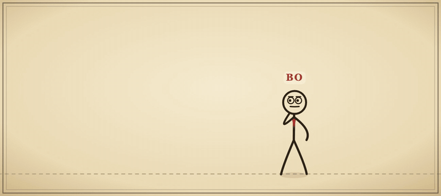
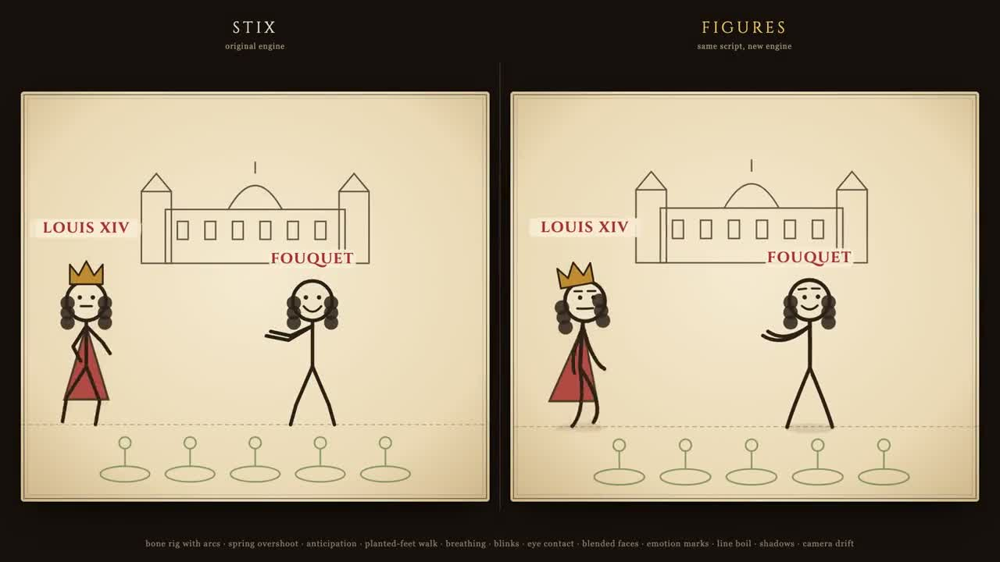

# figures

**Stick figures that act.** A tiny, dependency-free SVG engine for expressive explainer animations. Each scene is a short JSON script, and each frame is a pure function of time.



Same script, two engines. Left: the original [stix](https://github.com/bassimeledath/stix)-style renderer. Right: `figures`.

[](media/side_by_side.mp4)

## Why figures

Most stick-figure animators hold a pose, snap to the next one, and freeze in between. `figures` keeps the simple JSON scripting but animates like a cartoonist would:

- **A real rig.** Bones rotate around joints, so limbs keep their length and hands travel on arcs. Two-bone IK, and walk and run cycles driven by distance, keep feet planted with no skating. The body bobs and the arms swing.
- **The principles of animation, built in.** Transitions are springs with overshoot and settle. Big gestures get anticipation and squash and stretch. Hair, hats, ties, robes and props trail the motion. Turnarounds animate.
- **Characters who are alive.** They breathe, sway and blink, and their eyes find whoever is nearby.
- **Faces that act.** Brows, eyes and mouths blend between 11 expressions. Emotion marks appear on their own: shock lines, an anger mark, sweat drops, laugh lines.
- **A hand-made look.** Ink lines boil 12 times a second, limbs curve, figures cast ground shadows, stops kick up dust, and the camera drifts gently.
- **Deterministic and parallel.** `FIGURES.svg(spec, t)` has no hidden state, so you can split a video into chunks and render them in parallel, and every frame matches a single pass.

## Use it as an agent skill

`skills/figures/` is a self-contained agent skill. It holds `SKILL.md` (the workflow), `references/` (the spec and acting patterns) and `scripts/check_spec.py` (a spec linter). It works with Claude Code, Hermes, Codex and any agent that loads `SKILL.md` folders:

```bash
git clone https://github.com/cherifya/figures
cp -r figures/skills/figures ~/.claude/skills/      # Claude Code
cp -r figures/skills/figures ~/.hermes/skills/      # Hermes
```

Then ask your agent for something like: *"Animate a 10-second scene where a kid teaches her dad a handshake."* The skill walks it through four steps:
1. plan the beats;
2. write the JSON;
3. lint it with `check_spec.py`;
4. review the rendered stills, then render the video.

## Quick start

**Browser**

```html
<div id="stage" style="width:900px;height:400px"></div>
<script src="src/figures.js"></script>
<script>
  fetch('examples/hello.json').then(r => r.json()).then(spec => {
    const t0 = performance.now();
    (function tick(now) {
      stage.innerHTML = FIGURES.svg(spec, ((now - t0) / 1000) % spec.duration);
      requestAnimationFrame(tick);
    })(t0);
  });
</script>
```

**Player** (scrub, slow down, load your own JSON):

```bash
python3 -m http.server   # then open http://localhost:8000/tools/player.html
```

**Node**

```js
const FIGURES = require('./src/figures.js');
const svg = FIGURES.svg(require('./examples/hello.json'), 2.5); // SVG string for t = 2.5 s
```

## Render to video

```bash
pip install playwright && playwright install chromium   # plus ffmpeg on PATH
python3 tools/render.py examples/hello.json hello.mp4 --workers 4
python3 tools/render.py examples/hello.json hello.gif --size 1350x600
python3 tools/render.py examples/hello.json qa/ --stills 1.5 4.0 6.7   # PNG stills for review
```

The renderer splits the frame range across `--workers` headless browsers, then encodes once. It uses Apple VideoToolbox when available, otherwise libx264.

Measured on a MacBook Air (M5) at 1920×1080:

| | frames/s |
|---|---|
| Building one frame's SVG | 0.05–0.3 ms (not the bottleneck) |
| 1 browser | about 29 |
| 4 browsers in parallel | about 82–97 |

Screenshots dominate the cost, which is why chunked parallel rendering pays off.

## Writing scenes

```json
{"w": 900, "h": 400, "ground": 355, "duration": 6,
 "fx": [{"type": "bubble", "x": 240, "y": 122, "t0": 2.2, "t1": 4, "text": "Hi there", "tail": -1}],
 "actors": [
  {"label": "ADA", "s": 1.3, "keys": [
    {"t": 0, "x": -80, "y": 286, "pose": "standing", "expr": "neutral"},
    {"t": 2.0, "x": 330, "move": "walk", "expr": "happy"},
    {"t": 2.4, "pose": "waving", "wiggle": {"p": 0.4, "a": 6}}]}]}
```

The full reference covers 40 poses, 11 expressions, looks, props, effects and keyframing: **[skills/figures/references/spec.md](skills/figures/references/spec.md)**.

## Test

```bash
node tests/smoke.js    # renders every frame of every example; fails on NaN or undefined
```

## Credits

The pose library, props and effects are derived from [stix](https://github.com/bassimeledath/stix) by Bassime Ledath (MIT). The rig, motion system, faces and renderer are new in `figures`. The `mirror` and `court` examples come from a stick-figure explainer series on power and history.

## License

MIT. See [LICENSE](LICENSE).
